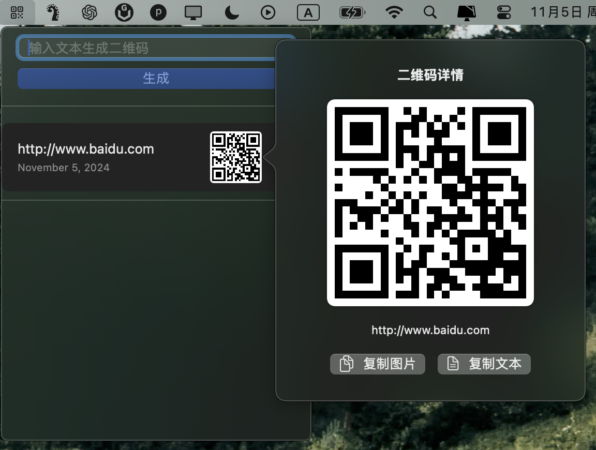

# qrcode_generator


一个简单的二维码生成器应用，运行在 macOS 状态栏。

## 下载安装

[下载最新版本](https://github.com/Hao-yiwen/qrcode_generator/releases/)

## 功能特点

- 快速生成二维码
- 支持历史记录
- 一键复制和删除
- 从剪切板快速复制
- 快速搜索
- 二维码放大预览

## 系统要求

- macOS **13.5** 或更高版本（菜单栏 `MenuBarExtra` 需要 macOS 13+）

## 安装说明

- 下载 QRCodeGenerator.dmg
- 打开 DMG 文件
- 将应用拖入 Applications 文件夹
- 首次运行时右键点击应用选择「打开」

## 开发环境与本地运行

本项目为纯 SwiftUI / AppKit macOS 应用，**无 CocoaPods / SPM 第三方依赖**，仅使用系统框架（SwiftUI、AppKit、CoreImage、Carbon）。

### 环境要求

| 项目 | 要求 |
|------|------|
| macOS | 13.5+（建议在较新的 macOS 上开发） |
| Xcode | **16.0 或更高**（工程使用 `objectVersion = 77` / `PBXFileSystemSynchronizedRootGroup`，需 Xcode 16+） |
| Swift 语言模式 | **5.0**（`SWIFT_VERSION = 5.0`，由当前 Xcode 自带工具链编译） |
| Deployment Target | **macOS 13.5**（工程级与各 Target 已统一） |

### 运行步骤

1. 用 Xcode 16+ 打开 `qrcode_generator.xcodeproj`
2. 选择 Scheme：`qrcode_generator`，目标选「My Mac」
3. 如需签名运行：在 Signing & Capabilities 中选择你自己的 Development Team（仓库默认 Team ID 可能无法直接使用）
4. 按 `⌘R` 运行；应用为菜单栏（`LSUIElement`）应用，停靠栏通常不显示图标，请在菜单栏查找二维码图标
5. 运行测试：`⌘U`，或 Product → Test

命令行（仅在 Mac 上）：

```bash
xcodebuild -project qrcode_generator.xcodeproj \
  -scheme qrcode_generator \
  -configuration Debug \
  -destination 'platform=macOS' \
  build
```

## 常见问题

如果提示「无法打开应用程序」，请尝试：

1. 右键点击应用选择「打开」
2. 在系统设置的安全性与隐私中允许打开
3. 如果仍然无法打开，请在终端中运行：

```bash
xattr -cr /Applications/qrcode_generator.app
```

## 预览



## 支持我的工作

如果这个项目对你有帮助，可以请我喝杯咖啡 ☕️

<details>
<summary>
  
</summary>
<br>

</details>
